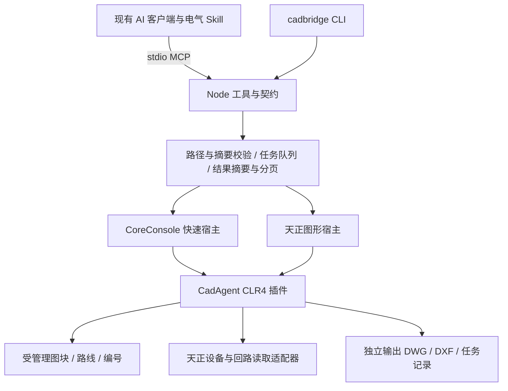

# CAD AI Bridge 技术方案与交付边界

本项目把本地 AutoCAD 的电气读图和批量制图封装为 MCP 工具与 CLI。首个公开预览版本面向 Windows x64、AutoCAD 2022、T20 天正电气 V8.0，提供可复现的测试图和源码。项目可以在现有 AI 客户端中使用，不维护聊天平台，也不管理模型 API 密钥。

## 用户流程

1. 安装 Node.js 22.19+ 和本地已授权的 AutoCAD；需要原生对象时安装天正电气。
2. 在项目中运行 `npm ci`，再运行 `npm run setup -- --workspace <图纸工作目录>`。setup 自动发现安装、编译自己的插件、生成本地 MCP 配置，并备份已有项目配置。
3. 将生成的 `mcp-config.local.json` 导入支持本地 stdio 的 MCP 客户端。使用 `npm run doctor` 查看状态，使用 `npm run demo` 验证绘图闭环。
4. AI 先读取摘要，必要时分页取设备或回路；将布置、连线和编号合并为一次原子请求。输出为新 DWG，源图保持不变。

首次运行的普通提示、正常授权和真正的加载错误分别处理。软件的账户或授权流程由用户正常完成；天正日积月累提示由任务宿主临时抑制并恢复。加载失败返回任务目录和具体阶段，不能把超时自动当作没有写入。

## 对标与采用方式

| 来源 | 借鉴内容 | 本项目的具体落实 |
| --- | --- | --- |
| [bimwright/dwg-mcp 架构](https://github.com/bimwright/dwg-mcp/blob/master/ARCHITECTURE.md) | 外部网关与 CAD 插件分离、宿主版本边界、任务串行化 | Node MCP 网关与 CLR4 CAD 插件分离，明确只验收 2022，跨进程互斥锁保护宿主配置与任务 |
| [dwg-mcp 安装器](https://github.com/bimwright/dwg-mcp/blob/master/scripts/install.ps1) | 检测、配置备份、分发清单 | setup、doctor、本地配置备份、插件摘要与发行文件清单 |
| [earthtojake/text-to-cad](https://github.com/earthtojake/text-to-cad) | CLI、MCP、Skills、预览组合成完整能力 | 同一执行内核供 CLI/MCP 调用；电气 Skill 负责工作流；实际 DWG/DXF 与可重建 SVG 演示 |
| [MCP Inspector](https://github.com/modelcontextprotocol/inspector) | 工具发现、调用与协议排障 | 使用官方 SDK 客户端做真实 MCP 握手和端到端测试；错误返回保留稳定代码和证据 |

以上是独立实现的设计借鉴，没有复制上述项目的源代码。当前批处理宿主不等价于 dwg-mcp 的常驻通信；text-to-cad 的参数化三维内核也不作为天正电气内核使用。

## 架构与职责

工具契约负责输入边界，不把模型输出当作可执行代码。Node 层负责工作目录、源文件快照、SHA-256、队列和任务证据。PowerShell 宿主负责启动参数、进程归属、精确目录加载、普通启动提示和配置恢复。C# 插件负责数据库事务、稳定身份、幂等、CAD API 与专业适配。

选择 CoreConsole 可降低普通读图和修改的启动成本。需要解析天正自定义对象时选择 `host: tangent`；图形宿主依赖可用桌面会话。两种后端调用相同业务契约，调用者可以核对结果差异。

### 天正加载

完整天正电气 ARX 与独立对象解释器是两套安装。打开带代理对象的图纸时，AutoCAD 可能先按注册信息寻找独立解释器。图形宿主使用安装配置与 `/ld` 明确预载完整天正内核，避免先选到另一套同名模块；`/b` 位于启动参数末尾。依据 [AutoCAD 2022 启动参数](https://help.autodesk.com/cloudhelp/2022/ENU/AutoCAD-Core/files/GUID-8E54B6EC-5B52-4F62-B7FC-0D4E1EDF093A.htm)。

`NETLOAD` 用于本项目 .NET 插件，`ARXLOAD` 或官方 `/ld` 用于原生模块。安全加载保持开启。宿主仅临时信任自己的精确插件目录，任务后恢复原值；比较路径时处理 AutoCAD 的环境变量展开及分隔符规范化。真正的外部配置变化保留并报告冲突。

图形进程使用显式 CreateProcess 与普通用户权限，避免 ShellExecute 在本机 RUNASADMIN 配置下无限等待；该选择不修改兼容性注册表。进程启动时记录 PID、时间、路径和任务目录，超时只终止本任务拥有的进程。

## 数据模型

### 受管理图纸

- `documentId` 与 `revision` 随 DWG 的 Xrecord 保存。写入同时校验文件摘要、文档身份和预期版本。
- 设备具有稳定业务 ID、图块、位置和属性；`DEVICE_ID` 是本项目的可见设备编号。
- 路线保存显式 WCS 顶点、回路 ID、起止设备和端口。当前测试端口 `PWR` 位于图块插入点。
- 同一请求 UUID 与内容重放不重复写入；UUID 内容冲突、版本过期或后续操作失败会拒绝或回滚。跨 DWG 分支仍需独立管理。

### 天正读取

V8 示例中的 `light`、`socket`、`DEVTYPE`、`设备名称`、`EES_Fire` XData 用于有依据的设备识别。导线按 `ltype`、`ldm`、`lmeth`、`linst`、`lnoar`、`lnorm`、`linenum` 分组和读取，原始类型和值一并保留。`linenum` 提供观察到的回路编号，不推导未验证的设备拓扑或电气负荷。

普通实体、天正自定义对象与代理分别报告。未知对象计入覆盖范围；不通过删除、炸开或覆盖元数据来伪造支持。默认只统计模型空间根层，嵌套块和外参明确排除。

图纸单位为 Undefined 时，只返回图面长度；调用者明确提供 `units: mm` 后才返回毫米值，并标注单位来自假设。已有其他单位不能被该假设覆盖。

### 天正写入边界

预览版在自行生成、明确标记的灯具和插座定义上写入观察到的设备标志与导线回路字段，并验证保存、重开和读取。此能力不宣称等同于完整天正 SDK，不开放对未知厂家图库或既有工程对象的任意修改。

测试中的设备编号写入 `DEVICE_ID`；回路编号写入新路线的 `linenum`。天正 `rybz/jxbz/pmbx/hlbh/yjbh/hljc` 的原生命令名称已解析，但其全部交互提示和对话框参数尚不作为公开自动化契约。原生桥架创建、专用标注关联及厂家统计命令一致性保留为后续专项能力。

## 工具表面与效率

| 工具 | 作用 |
| --- | --- |
| `cad_create_test_drawing` | 创建可重建的普通或天正适配测试模板 |
| `cad_inspect` | 读取受管理图纸身份与实体 |
| `electrical_apply` | 原子执行布置、显式路径连线、编号 |
| `electrical_takeoff` / `electrical_validate` | 受管理设备统计和连接/编号校验 |
| `tangent_inspect` / `tangent_takeoff` | 天正设备、导线和回路读取与统计 |
| `cad_read_result` | 对已有完整结果分页，每页至多 100 条，不再启动 CAD |
| `cad_native_status` | 使用图纸副本检查独立原生宿主 |

天正读取默认返回摘要、少量样例和分页入口，完整记录落在任务目录。一次批量请求合并多个修改，避免每画一条线就启动一次宿主。只读 MCP 模式隐藏写入工具。所有业务工具均为结构化操作，公开接口不执行任意 LISP、C# 或 shell。

## 测试与发布门槛

普通 CI 不要求 CAD，测试契约、文件边界、配置选择、备份、结果摘要和分页。真实 CAD 测试通过 MCP SDK 启动实际宿主，验证原子任务、失败回滚、重放、摘要与图纸身份，并独立读取导出的 DXF。

天正验收另外检查原生模块、命令解析、安全加载、五个设备与两条回路、保存后新进程重开、两个后端统计一致、厂家示例识别、未定义单位，以及代理对象在原生宿主中的解析。厂家原图和源副本需保持哈希一致。任何未通过项目保留失败记录，不计入成功报告。

发行前需通过单元测试、普通 CAD 与天正 CAD 验收、源码及依赖清单检查、文档链接与示例检查、便携包内容检查。公开内容包括独立源码、生成方法和合成预览；真实工程图、天正/Autodesk 二进制、厂家图库、厂家示例、个人路径和任务缓存不进入仓库。

## 版本演进

| 阶段 | 交付 | 验收 |
| --- | --- | --- |
| 0.2 开发者预览 | 双后端、天正读取、受控合成图写入、setup/doctor/CLI/MCP/Skill、分页与测试 | 本机 2022/V8 实测与普通 CI；首次配置可重现；不需要 REA 运行依赖 |
| 0.3 交互优化 | 常驻 CAD 会话、受保护 IPC、预览确认、精确文档选择、可取消任务 | 宿主线程与文档锁验证；断连恢复；热调用时延实测；不重复写入 |
| 专业适配 | 已授权本地图块目录、实际连接端口、既有设备编号、专用标注与桥架 | 每个适配器独立样图与厂家结果对照；版本兼容矩阵 |
| 普通用户发行 | Windows 安装/便携向导、客户端配置适配和恢复 | 干净 Windows 环境验收；升级/卸载归属验证；发行校验和 |

当前仓库以 0.2 预览的已实现范围作为首次公开边界，后续阶段不作为现成能力宣传。桌面向导将调用同一配置与诊断内核，避免两套安装逻辑。首次上传由仓库所有者在本地检查后自行执行；本次任务不创建远程仓库、不推送、不发布发行版。
